## Introduction

Robots have become increasingly good at human tasks. Some even think robots will become more capable than humans. So let us put a robot to the test with a challenge even the most skilled humans cannot do: stop Messi from dribbling past an entire team.

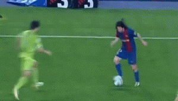

<table>
  <tr>
    <td align="center">
      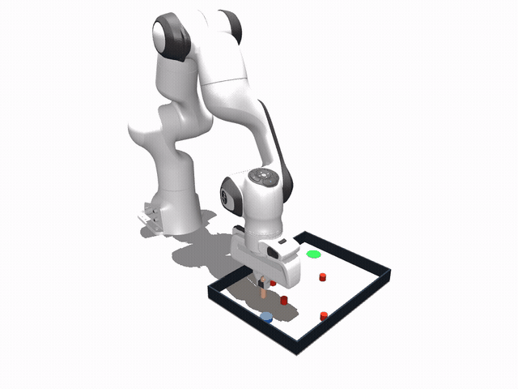<br/>
      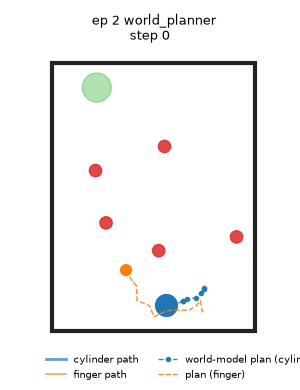
    </td>
    <td align="center">
      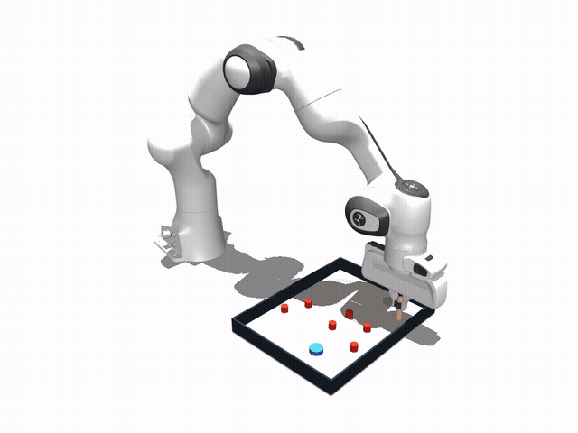<br/>
      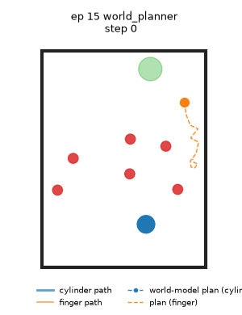
    </td>
    <td align="center">
      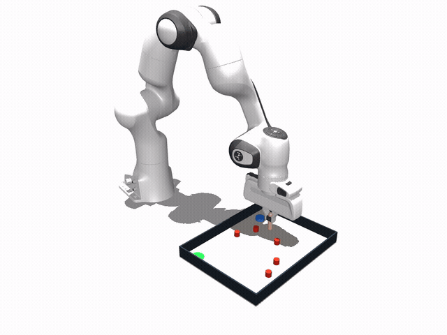<br/>
      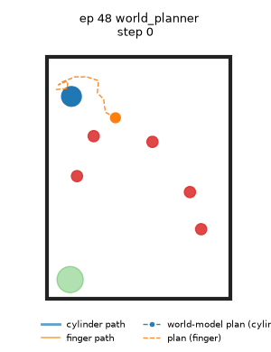
    </td>
  </tr>
</table>

In this simplified scenario, a Franka Panda plays Messi in a MuJoCo simulation. The ball is a bottle cap. The foot is a probe held by the robot's gripper. The defenders are fixed obstacles. The goal is a target disc on the floor. The robot must push the cap from one side of the board to the goal without touching an obstacle.

Defending against Messi requires a player to anticipate where he will dribble next. A **world model** (WM) was trained to answer this problem: given the probe’s position relative to the cap and its impending motion, where will the cap be a tenth of a second later?

To assess whether these predictions are accurate enough to support action, we implemented a **planner** that samples candidate probe paths, predicts the resulting cap's position for each using the WM, and executes the path that best advances the cap toward the goal past the obstacles.

## Pipeline

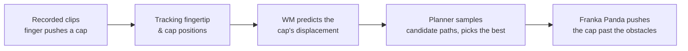

## Methods

### Data

Phone fixed above a 28 x 37 cm board. A 3 cm bottle cap is pushed with the index finger among 1.5 cm obstacles. 68 clips, 9 minutes in total: straight pushes, multi-direction sequences around obstacles, fast and slow pushes, and 14 clips where the finger moves near the cap without touching it. Camera settings: 1080p resolution, 30fps, and AE/AF lock.

### Tracking

The four corners are detected once for the session and the board's dimensions are used to map pixels to metres. The cap is tracked by colour. The fingertip is tracked with MediaPipe hand landmarks. Both are sampled at 10 Hz. This gives 3367 transitions of fingertip position, cap position, fingertip move, and cap move.

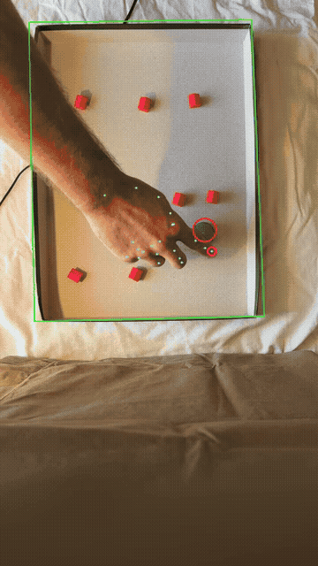

### World model

Input: the cap's position relative to the fingertip, and the fingertip's displacement. Output: the cap's displacement. Five small MLPs form an ensemble where their disagreement is an uncertainty signal. Training data is augmented with random rotations and reflections. Split: 48 train, 10 validation, 10 test.

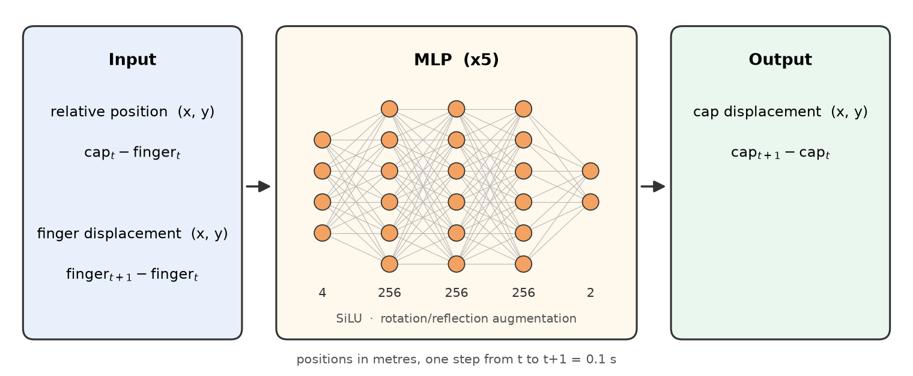

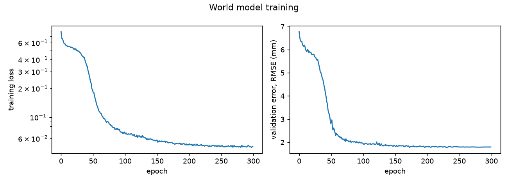

We selected a low-dimensional dynamics model over state-of-the-art visual WMs (e.g., V-JEPA 2-AC, DINO-WM, Cosmos) because inferring from pixels is unnecessary here: with a fixed camera and a scene containing only a disc and a fingertip, the state is directly observable as four variables. Visual WMs would also require substantially more data and compute, and would still face a human-hand-to-robot-probe gap in image space. Given nine minutes of demonstration data, a small MLP on the extracted state is the better fit. It trains in about a minute on a NVIDIA RTX 4060 laptop GPU (8 GB) and can be queried at ~10⁵ evaluations per second, which the planner needs. We feed the model the relative position, which makes it invariant to where the push occurs in the workspace, and apply rotation and reflection augmentation to enforce isotropy of the contact dynamics. 

### Simulator

We modelled the box, cap, and obstacles in MuJoCo using their measured dimensions. The robot pushes with a rigid probe. We did not learn a hand-to-robot mapping since the task requires the robot only to push the object, not to reproduce a specific human hand motion.

A rigid probe contacts the cap at a single distance, whereas a soft fingertip does not; in the recorded clips, the cap begins to move when the tracked fingertip is 15-25 mm from its centre. We therefore chose the probe radius so that the contact distance (cap radius plus probe radius) falls within this band and the contact resembles a finger pad. A 2.5 mm pin satisfied the first criterion but not the second, as it pushed the light cap unreliably in simulation. A 7.5 mm probe contacts the cap at 22.5 mm and reproduces the pushing behaviour seen in the clips.

Floor friction could not be measured directly, so we swept five values and kept the one at which the WM best predicted simulated cap pushes. 

### Planner

Cross-entropy method over 12-step probe paths, 1024 samples, 4 rounds. The cost consists of the cap's distance to the goal along obstacle-free paths, penalties for the cap or probe colliding with an obstacle or wall, the ensemble's disagreement, and a small effort term. 

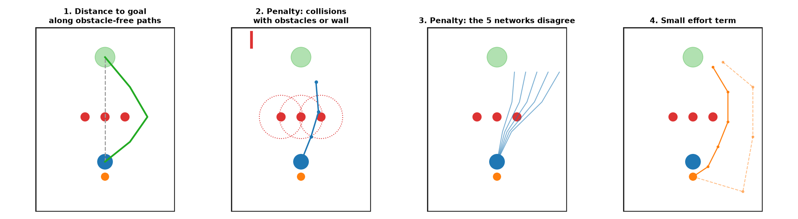

We evaluated three strategies:

- World-model planner (`world`): the planner with the model trained on the recorded clips.
- Sim-data planner (`sim`): same planner, same network, but trained on pushes recorded inside the simulator with the robot’s probe. No transfer from recorded clips.
- Rule planner baseline (`b0`): same planner, no network. Cap motion is predicted by a hand-written rule: it moves with the probe when touched, otherwise it stays. 

### Benchmark
Two layouts, 100 episodes each.
- Barrier: three obstacles in a row across the straight line from start to goal. 
- Opposite sides: start and goal in opposite edge zones of the box, 4 to 6 obstacles in between.

An episode fails when the cap or the probe touches an obstacle, or after 80 steps (8s). Success means the cap's centre is within 2 cm of the goal.

## Results

### World model

#### On the 10 test clips:

|                                 | 1-step error | 1-step error, cap moving | 12-step open-loop error |
| ------------------------------- | -----------: | -----------------------: | ----------------------: |
| world model                     |   **1.9 mm** |                   2.4 mm |               **18 mm** |
| predict "the cap does not move" |       6.6 mm |                        – |                   73 mm |

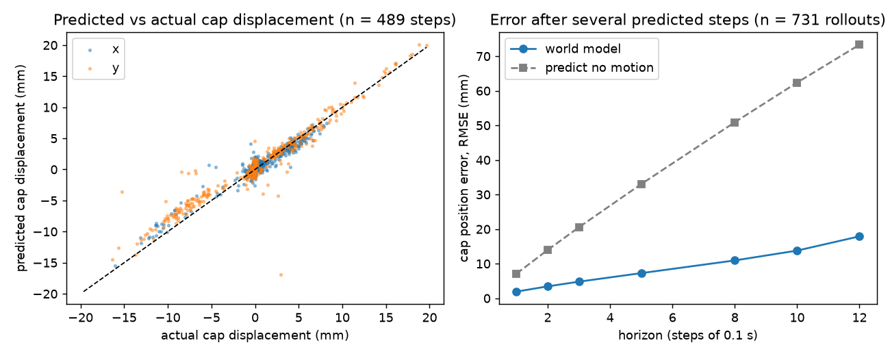

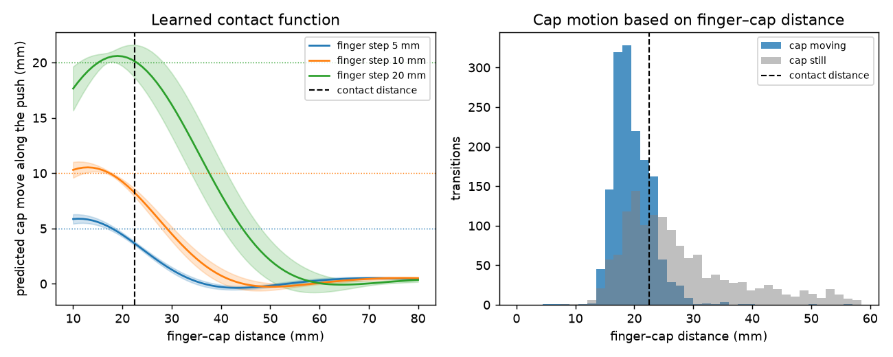

#### On the simulator's own pushes (unseen during training):

- 3.4 mm 1-step error
- 7.2 mm when predicting no motion → real-to-sim gap

### Robot control in simulation

| layout   | controller | success | collision | timeout | median steps (success) | median min clearance |
| -------- | ---------- | ------: | --------: | ------: | ---------------------: | -------------------: |
| barrier  | `b0`       |      27 |        62 |      11 |                     36 |                14 mm |
| barrier  | `world`    |  **71** |        24 |       5 |                     26 |                21 mm |
| barrier  | `sim`      |     100 |         0 |       0 |                     25 |                33 mm |
| opposite | `b0`       |      30 |        66 |       4 |                     43 |                14 mm |
| opposite | `world`    |  **66** |        19 |      15 |                     33 |                24 mm |
| opposite | `sim`      |      91 |         4 |       5 |                     29 |                32 mm |

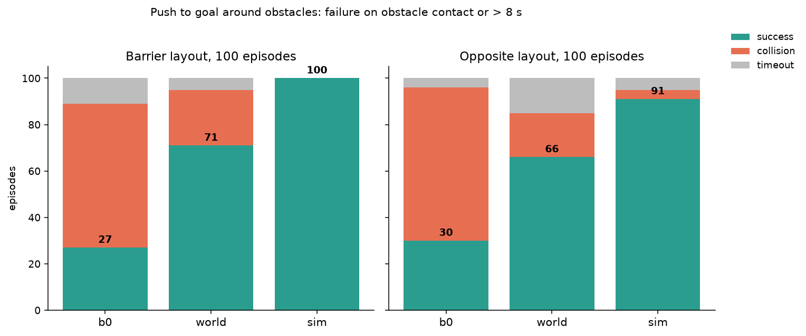

Every episode can be watched as a schematic animation under `docs/media/<layout>/<controller>/schematic/`, named by its index and outcome.

## Discussion

### World model
The model tracks cap displacements from −15 to +20 mm along the diagonal of the predicted-versus-actual plot. The one-step error on the test clips is 1.9 mm. As a baseline, we use a “no motion” predictor that assumes the cap never moves. The cap is stationary in about half of the recorded steps, so this baseline is non-trivial. Its error is 6.6 mm, more than three times higher. The WM therefore learned when the cap moves, not only that it often stays still. 

The rollout plot shows how error accumulates without feedback. After 12 steps, the open-loop error is 18 mm, against 73 mm for no motion. Twelve steps is the planner’s horizon, so 18 mm is the largest error the controller relies on.

The learned contact function shows what the model has captured. For a straight push, the predicted cap displacement equals the finger displacement up to about 20 mm of finger-cap distance. It fades to zero by 40 mm, and the ensemble is least certain in this transition. The recorded steps show the same band: the cap moves when the fingertip is 15-25 mm from its centre. We attribute the width of this band to the soft finger pad overhanging a cap that is only 1 cm tall. The model learned this rule without it being specified. The probe’s contact distance of 22.5 mm lies inside the band the model trusts.

On simulated pushes not seen in training, the one-step error rises to 3.4 mm (7.2 mm for no motion). We attribute this gap to the rigid probe replacing a soft finger and to to a friction value that was de rather than measured.

A variant WM conditioned on the previous step reached a lower one-step error (1.3 mm). However, its 12-step error exceeded 30 mm, and it succeeded in 0 of 10 planning trials, so it was discarded. 


### Robot control
The benchmark figure and table rank the three controllers identically on both layouts. The sim-data planner reaches 100 and 91 of 100, the world-model planner 71 and 66, the rule planner 27 and 30. The sim model is best because it learned the simulator’s own physics: rigid contact at exactly one distance, the simulator’s friction, and random pushes from every angle. 

The rule planner is an ablation that isolates what the recordings contributed. It uses the same planner and cost, but replaces the learned model with the rule “the cap moves with the probe when touched”. Success drops by more than half, and collisions rise to over 60 per layout. A rigid rule cannot represent a cap slipping sideways off a glancing push. The learned model can, so its predicted paths are realised more often.

The controllers also fail in different ways. The rule planner fails mainly by collision. We attribute this to predictions that are confidently wrong near obstacles: its median clearance of 14 mm is below the planner’s 20 mm margin. The world-model planner also fails mostly by collision (19 and 24 episodes), but keeps a clearance of 21-24 mm. These collisions concentrate in the contact transition region, where errors of a few millimetres turn into touches. Its remaining failures on opposite-side layouts (15 timeouts) come from stalling in front of dense obstacle fields, where every path near the cap is penalised. The sim-data planner rarely fails and keeps the widest clearance (32-33 mm). Its accurate predictions allow a more cautious approach.

Successful episodes are shorter for better models: 25-29 steps for the sim-data planner, against 36-43 for the rule planner. A correct model finds a direct route, whereas a wrong model re-approaches the cap after failed pushes. The per-episode schematics show these behaviours: detours around the barrier, re-approaches after a slipped push, and straight runs into obstacles by the rule planner.

### Imitation learning
We also fine-tuned SmolVLA on the same 54 push clips (the 14 non-contact clips were not considered). We replayed the clips in the simulator, pairing each overhead image with the recorded fingertip motion. Training converged. Offline, the predicted action points in the correct direction on 90% of frames. In closed loop, the policy succeeded in 0 of 100 episodes on both layouts. Collisions caused 38 and 40 failures, respectively. The rest timed out. 

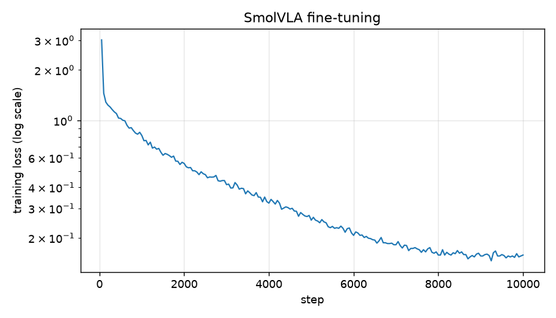

The same recorded clips give more than two-thirds success rate when used to learn dynamics for planning, and none when used for imitation. This contrast is the main data-efficiency result. The WM answers a narrow question that the data directly supports: how the cap responds to a push. The planner supplies goal-seeking and obstacle avoidance through search. The imitation policy must learn both from 54 trajectories and generalise to unseen layouts, but this amount of data does not support that.

### Future work
The present setup simplifies the real scenario. To better anticipate the attacker’s dribble and stop it, we recommend the following:

- A defender cannot read the attacker’s intended motion from two tracked points. It must infer intent from posture and motion. This calls for a pixel or latent WM. Such a model would also capture what the 2D state omits, notably the cap’s spin after off-centre pushes, which is likely the main source of the 12-step error.

- Real defenders move. Obstacles should become agents in motion with their own dynamics, and the geodesic cost map should be rebuilt at every step rather than once per episode. The 10 Hz replanning loop already allows this.

## Quickstart

Set up virtual environment and package:

```
uv venv --python 3.12 .venv && source .venv/bin/activate
uv pip install -e ".[test]"
```

Download the data (543 MB):

```
curl -L -o phone_clips.zip \
    https://github.com/arthurlevis/capWM/releases/download/data-v1/phone_clips.zip
unzip -q phone_clips.zip -d data/raw
```

Process clips as trajectories:

```
# detect the box corners once for the session
python scripts/calibrate_all.py

# track fingertip and cap in every clip, write 10 Hz trajectories 
python scripts/extract_videos.py --overlay
```

Train and evaluate the world model:

```
# train on the recorded trajectories
python scripts/train_state_wm.py \
    --data data/processed/video \
    --out models/wm_video_h0.pt \
    --history 0
```

Run the benchmarks:

```
# world-model planner
python scripts/plan.py \
    --policy wm --model models/wm_video_h0.pt \
    --opposite --episodes 100 --seed 600 \
    --out outputs/eval/eval_opposite_world_planner.json \
    --save-logs outputs/logs/logs_opposite_world_planner.npy

# sim-data planner
python scripts/plan.py \
    --policy wm --model models/wm_sim_h0.pt \
    --opposite --episodes 100 --seed 600 \
    --out outputs/eval/eval_opposite_sim_planner.json

# rule planner
python scripts/plan.py \
    --policy rule \
    --opposite --episodes 100 --seed 600 \
    --out outputs/eval/eval_opposite_rule_planner.json
```

Render episodes:

```
# one schematic gif per episode, named by index and outcome
python scripts/render_all_episodes.py \
    --logs outputs/logs/logs_opposite_world_planner.npy \
    --out docs/media/opposite/world_planner/schematic

# isometric view of the robot for selected episodes
python scripts/render_panda_episodes.py \
    --layout opposite --episodes 2 15 48 \
    --out docs/media/opposite/world_planner/panda
```

Run the tests. Two of them read `data/raw/IMG_0527.MOV`, so download the clips first:

```
# everything
pytest tests

# one area at a time
pytest tests/test_calib.py          # box calibration (needs the clips)
pytest tests/test_tracking.py       # colour and fingertip tracking (needs the clips)
pytest tests/test_trajectories.py   # trajectory handling and augmentation
pytest tests/test_world_model.py    # shipped model behaviour, training on a synthetic rule
pytest tests/test_sim.py            # simulator: placement, pushing, collisions, layouts
pytest tests/test_planner.py        # geodesic cost and planning
pytest tests/test_results_table.py  # results collection
```
